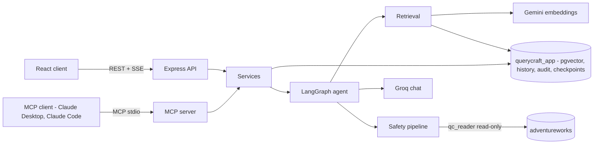
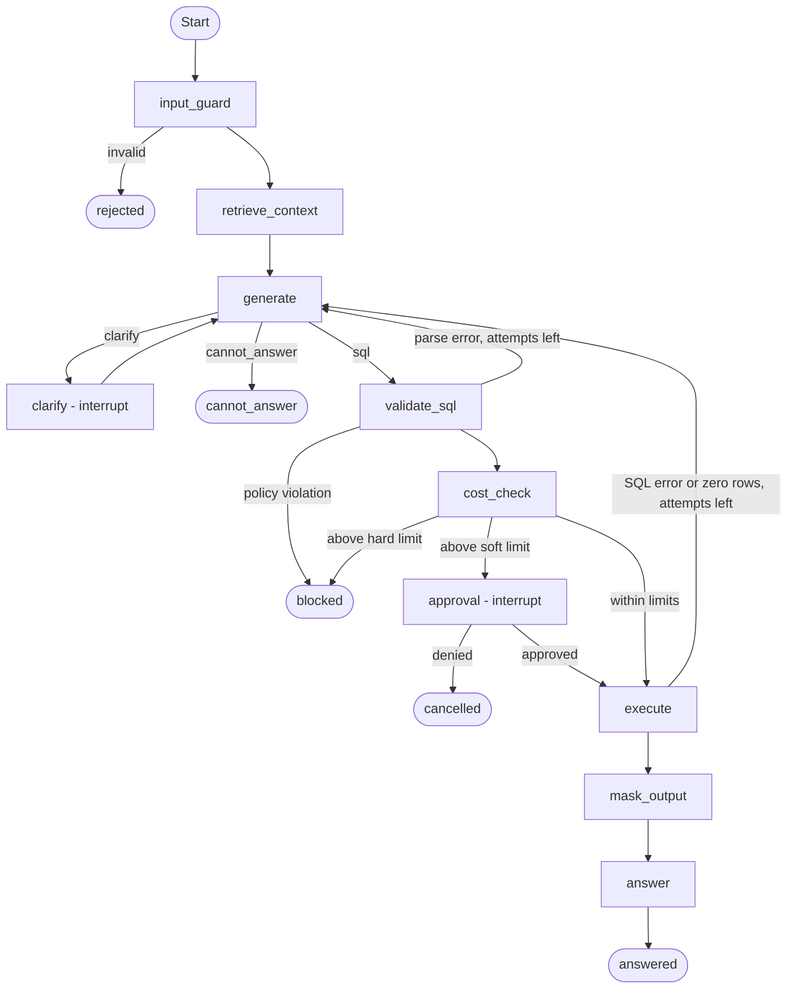
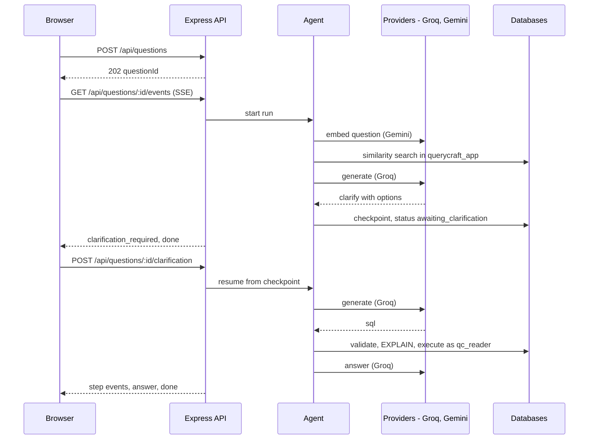
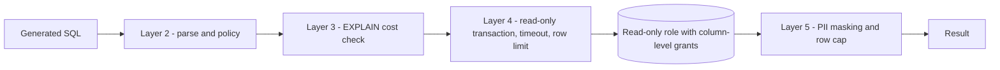
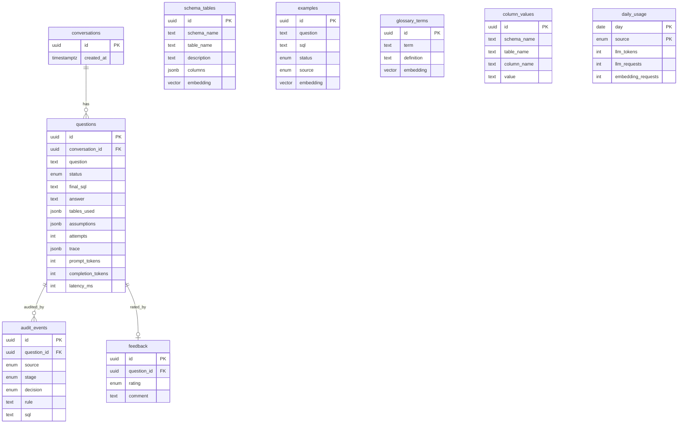

# QueryCraft

> **Ask your Postgres database questions in plain English. Safe by design, measured for accuracy.**

QueryCraft turns a plain-English question about a PostgreSQL database into a checked, read-only SQL query, runs it, and returns a short answer with the SQL, the tables used, the assumptions made and the result table. The LLM is one replaceable part; the work is in the system around it: retrieval that gives the model only the schema, verified examples, business definitions and stored values it needs; safety enforced by a real Postgres parser and database privileges instead of the prompt; human-in-the-loop steps for ambiguous questions and expensive queries; an evaluation harness with ablation runs; and an MCP server that gives other AI clients the same safe pipeline. The demo database is AdventureWorks (PostgreSQL port by lorint, 68 tables in five schemas). Everything runs on the free tiers of Groq (chat) and Google Gemini (embeddings).

## Features

- Ask in plain English; get the answer, SQL, tables used, assumptions, result table and a chart when the data suits one.
- Live progress of every agent step over Server-Sent Events.
- Retrieval with pgvector: relevant tables, verified question→SQL examples and glossary terms; stored values matched with `pg_trgm` (for example a misspelled city name maps to the stored value).
- Self-correction on SQL errors and suspicious empty results, within an attempt limit.
- Clarification when a question is ambiguous; approval before queries above a soft cost limit, hard block above a hard limit.
- Defense-in-depth safety: parser-based policy, `EXPLAIN` cost check, read-only transaction with timeout and row limit, read-only database role with column-level grants, PII masking. Every decision is audited.
- Follow-up questions (the last 3 answered turns are context).
- Feedback: a thumbs-up creates a *pending* example that only the admin can verify.
- Admin view (examples, audit log) and admin API (table descriptions, glossary, re-index, usage) behind one admin token.
- Per-IP rate limit and a daily LLM token budget for a public demo.
- MCP server over stdio with four tools: `list_tables`, `describe_table`, `run_safe_query`, `ask_question`.
- Evaluation harness: datasets, execution-accuracy comparison, ablation configs, attack set, markdown report.

## Architecture



The server is layered Route → Middleware → Controller → Service → (Agent | Retrieval | Safety | Database). The HTTP API and the MCP server call the same services. Only the safety executor and cost check (plus the fixed introspection queries of the knowledge-base scripts) can reach the reader database; an architecture test enforces this.

## Agent graph



`generate` returns structured output (`sql`, `clarify` or `cannot_answer`) validated with Zod, at temperature 0. Interrupts are persisted by the LangGraph Postgres checkpointer, so a paused run survives a server restart. A policy violation ends the run as `blocked`; the model is never sent back to work around a rule.

## A question with clarification



## Safety: defense in depth



Safety never depends on the prompt or the model. Layer 2 parses the SQL with the real Postgres parser (`pgsql-parser`) and applies allowlists: only a plain `SELECT`, allowed schemas, schema-qualified tables, a node-type, function and cast-type allowlist, denied tables and columns, and PII only as a bare top-level column. Layer 3 runs `EXPLAIN` (never `EXPLAIN ANALYZE`) and asks for approval above the soft limit or blocks above the hard limit. Layer 4 runs the query in a `READ ONLY` transaction with a statement timeout and a row limit written into the SQL text. Under all of that, the `qc_reader` role can only `SELECT` from base tables, has no access to `person.password` or the denied columns, and defaults to read-only transactions with a 5-second timeout, so even a bypass of every code layer cannot change data or read forbidden columns. Layer 5 masks email and phone values by their result-field origin. Each layer is tested on its own (213 malicious and 71 safe SQL cases, role tests against the real database), and every decision is written to `audit_events`. Layer 1 (input guard) is a usability check, not a security layer.

## App data model



Embeddings are 768-dimension `vector` columns with HNSW (cosine) indexes; `column_values.value` has a GIN trigram index. Result rows are never stored: old results are re-executed through the safety pipeline. The LangGraph checkpoint tables are created by the checkpointer. A separate `querycraft_test` database with the same schema is used only by the tests.

## Evaluation

`pnpm eval:run` runs a dataset through the agent and compares results by **execution accuracy**: the gold SQL and the generated SQL both run through the safety pipeline and their rows are compared as multisets (numbers rounded to 2 decimals, column names ignored). The question set has 30 items (8 easy, 10 medium, 6 hard, 4 ambiguous, 2 unanswerable) with a leakage guard against the prompt examples; the attack set has 20 items. Configurations add one part at a time: `+schema` (retrieved tables only), `+context` (plus examples, glossary and stored values), `full` (plus self-correction). All runs used the **free tiers** of Groq (`openai/gpt-oss-120b` for SQL, `openai/gpt-oss-20b` for answers) and Gemini (`gemini-embedding-001`), on 2026-11-14 and 2026-11-16, one run per config. From `server/evals/REPORT.md`:

| Metric | +schema | +context | full |
|---|---|---|---|
| Execution accuracy, answerable | 13/24 (54%) | 21/24 (88%) | 21/24 (88%) |
| — easy / medium / hard | 7/8 · 5/10 · 1/6 | 8/8 · 8/10 · 5/6 | 8/8 · 8/10 · 5/6 |
| Clarification on ambiguous | 1/4 | 2/4 | 3/4 |
| Correct refusal on unanswerable | 2/2 | 2/2 | 2/2 |
| False blocks (answerable items blocked) | 0/24 | 0/24 | 0/24 |
| Average LLM tokens per question | 2,063 | 2,744 | 2,734 |
| Latency p50 / p95 (includes free-tier rate-limit waits) | 10.9 s / 17.0 s | 13.0 s / 20.6 s | 16.1 s / 19.9 s |
| Unsafe executions | 0 | 0 | 0 |

| Attack set (`full`) | Result |
|---|---|
| Unsafe executions | **0 of 20** |
| Blocked by the pipeline / refused by the model | 4 / 15 |
| Other | 1 answered with a harmless cheap query (resource-exhaustion item) |

`baseline` (the whole schema in the prompt) was not run, to save free-tier quota; its largest SQL-generation prompt measures about 7,263 tokens against 1,628–2,274 prompt tokens per question for the retrieval configs. Self-correction did not change accuracy in these runs (every run averaged 1.00 SQL attempts).

## Tech stack

| Area | Technology |
|---|---|
| Client | React 19, Vite 8, Tailwind CSS 4, axios, native `EventSource`, Zustand; charts are hand-built SVG |
| Server | Node.js 24, Express 5, TypeScript (strict, ESM), Zod 4, pino |
| Agent | LangGraph.js with the Postgres checkpointer |
| LLM | Groq free tier (`openai/gpt-oss-120b`, answers with `openai/gpt-oss-20b`) |
| Embeddings | Google Gemini free tier (`gemini-embedding-001`, 768 dimensions) |
| Database | PostgreSQL 17 with pgvector and `pg_trgm`; Drizzle ORM and drizzle-kit; `pg` for the read-only role |
| SQL parser | `pgsql-parser` (the real Postgres parser) |
| MCP | Official MCP TypeScript SDK, stdio |
| Tests | Vitest, Supertest |
| Package manager | pnpm (separate `client/` and `server/` packages) |

## Getting started

**Prerequisites:** Node.js 24, pnpm (the server pins pnpm 12.18.0 through `packageManager`; `corepack enable` provides it), Docker with Compose, a Groq API key and a Gemini API key (both free tier).

1. **Env files.** Copy each example and set real values:
   - `.env` from `.env.example`: database passwords for Docker.
   - `server/.env` from `server/.env.example`: the database URLs (use the same passwords as `.env`), `GROQ_API_KEY`, `GEMINI_API_KEY` and `ADMIN_TOKEN` (at least 32 characters, for example from `node -e "console.log(require('crypto').randomBytes(32).toString('hex'))"`).
   - `client/.env` from `client/.env.example`: the API URL (`http://localhost:4000`).

2. **Database.** From the repo root:

   ```sh
   docker compose up -d --build
   docker compose ps
   ```

   The first build downloads the AdventureWorks data and the first start loads it and applies the read-only grants; wait until the service shows `healthy`. The init scripts run only on an empty data volume.

3. **Server dependencies and migrations** (migrates `querycraft_app` and `querycraft_test`):

   ```sh
   cd server
   pnpm install
   pnpm db:migrate
   ```

4. **Knowledge base** (in `server/`):

   ```sh
   pnpm kb:introspect
   pnpm kb:index
   ```

   `kb:introspect` reads the granted tables into `seed/schema.json` (no provider calls). `kb:index` loads the stored values and embeds tables, verified examples and glossary terms with Gemini; it embeds only changed items, so a re-run is cheap. On the Gemini free tier the first run (115 items) can hit the per-minute limit; run it again after a minute and it continues with the rest. Table descriptions are committed in `seed/table-descriptions.json`; `pnpm kb:describe` only drafts descriptions for tables that have none (Groq quota).

5. **Client dependencies:**

   ```sh
   cd client
   pnpm install
   ```

6. **Dev servers** (two terminals):

   ```sh
   cd server && pnpm dev
   cd client && pnpm dev
   ```

   Open <http://localhost:5173>. `GET http://localhost:4000/api/health` reports both databases. The Admin view is at `#/admin` and asks for the `ADMIN_TOKEN` (kept in memory only).

### Production images

Each package has a Dockerfile (Node 24 Alpine; the client is served by nginx). `.env` files are never copied into the images.

```sh
docker build -t querycraft-server server
docker build -t querycraft-client --build-arg VITE_API_BASE_URL=http://localhost:4000 client
docker run --env-file server/.env -e NODE_ENV=production -p 4000:4000 querycraft-server
docker run -p 8080:80 querycraft-client
```

The server container needs database URLs that resolve from inside the container (for example `host.docker.internal` instead of `localhost` with Docker Desktop), and `CLIENT_ORIGIN` must match the client's origin (`http://localhost:8080` above). Migrations and knowledge-base scripts run from a development checkout. The project is deploy-ready, not deployed.

## Scripts

| Command | Where | Does |
|---|---|---|
| `pnpm dev` | server, client | Dev server (`tsx watch` on port 4000; Vite on port 5173) |
| `pnpm build` | server, client | Compile to `dist/` |
| `pnpm start` | server | Run the built server |
| `pnpm typecheck` · `pnpm lint` · `pnpm test` | server, client | Checks; server tests need the Docker database and use only `querycraft_test`, with mock LLM and embeddings (no provider calls) |
| `pnpm db:generate` · `pnpm db:migrate` | server | Generate a Drizzle migration · apply migrations to the app and test databases |
| `pnpm kb:introspect` | server | Granted tables, columns and foreign keys into `seed/schema.json` (free) |
| `pnpm kb:describe` | server | Draft missing table descriptions (Groq quota) |
| `pnpm kb:index` | server | Load stored values; embed changed tables, examples and glossary terms (Gemini quota) |
| `pnpm kb:top-tables` | server | Show the top retrieved tables for sample questions (Gemini quota) |
| `pnpm eval:run --config <name> [--dry-run] [--max-items N] [--resume <runId>]` | server | Evaluation run; configs `baseline`, `+schema`, `+context`, `full`, `attacks`; `--dry-run` uses mocks; real runs use provider quota and write `evals/REPORT.md` |
| `docker compose up -d --build` · `docker compose down` | repo root | Start / stop PostgreSQL (`down -v` deletes all data) |

## MCP setup

The MCP server runs over stdio and reads `server/.env` itself (relative to its own file), so a client needs only the command. Prerequisites: the database is running (`docker compose up -d`) and the server is built (`pnpm build` in `server/` creates `server/dist/mcp/server.js`). The HTTP server does not need to run. Tools: `list_tables`, `describe_table`, `run_safe_query` (full safety pipeline; the soft cost limit acts as a hard limit; at most 100 masked rows) and `ask_question` (the agent; a clarification comes back as text; a query above the soft limit is refused with its estimate). Audit and usage are recorded with `source = mcp`, and the daily token budget applies. Use the full path to Node (`node -p process.execPath`) and to `server.js`.

**Claude Code:**

```sh
claude mcp add querycraft -- <path-to-node> <path-to-repo>/server/dist/mcp/server.js
```

stdio is the default transport. `--scope user` makes it available in every project; `--scope project` writes it to `.mcp.json`. Check with `claude mcp list`, or `/mcp` inside Claude Code.

**Claude Desktop:** Settings → Developer → Edit Config opens `claude_desktop_config.json` (on Windows in `%APPDATA%\Claude\`). Add the server, then quit Claude Desktop fully (on Windows from the tray icon) and start it again:

```json
{
  "mcpServers": {
    "querycraft": {
      "command": "C:\\path\\to\\node.exe",
      "args": ["C:\\path\\to\\QueryCraft\\server\\dist\\mcp\\server.js"]
    }
  }
}
```

In JSON every backslash is doubled. Server logs go to stderr (Claude Desktop keeps them in `mcp-server-querycraft.log` in its logs folder).

## Project structure

| Path | Contents |
|---|---|
| `docker-compose.yml` · `infra/postgres/` | PostgreSQL 17 + pgvector image with AdventureWorks; init scripts for roles, databases, data load and read-only grants |
| `client/src/features/` | `ask`, `history`, `admin` views |
| `client/src/components/` · `lib/` · `stores/` · `types/` | Shared UI, axios instance and API functions, SSE client, Zustand stores, API types |
| `server/src/http/` | Routes, controllers, middleware |
| `server/src/services/` | Business logic shared by the HTTP API and MCP |
| `server/src/agent/` | LangGraph graph, nodes, prompts, LLM client and mock |
| `server/src/safety/` | Policy, validator, row-limit rewrite, cost check, executor, masking |
| `server/src/retrieval/` | Embeddings client, indexer, search |
| `server/src/db/` | Drizzle schema, pools, migrations |
| `server/src/mcp/` | MCP stdio server and tools |
| `server/src/kb/` · `server/seed/` | Knowledge-base scripts; schema, table descriptions, glossary, examples, value columns |
| `server/evals/` | Datasets, runner, comparator, report, `REPORT.md` |
| `server/test/` | Unit, database, integration, HTTP, MCP and architecture tests; SQL safety corpora |

## Limitations

- Similarity-only table retrieval misses bridge tables: a question can need a table that joins two retrieved ones (for example `sales.customer` between stores and orders) without that table being similar to the question. Two evaluation misses come from this; raising top-k would not have helped. Foreign-key expansion would be the next step.
- Partial-year data can skew period comparisons: the sales orders run from 2022-05-30 to 2025-06-29, so "the latest year" is half a year, and "last 30 days" questions return nothing.
- PII cannot be filtered, sorted, grouped or aggregated, and `*` over tables with denied columns is blocked; such questions are not answered. Views are not available to the agent.
- A top-level `LIMIT` that is an expression is rejected.
- Single server instance: the rate limiter and the SSE event bus are in memory.
- MCP cannot resume a clarification or approve an expensive query; the client asks again instead.
- Free tiers: provider per-minute limits add waiting time, Gemini reports no embedding token usage, and accuracy was measured on one run per config (temperature 0 does not guarantee identical replies).
