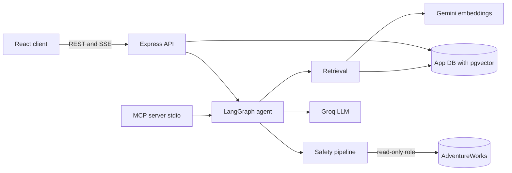
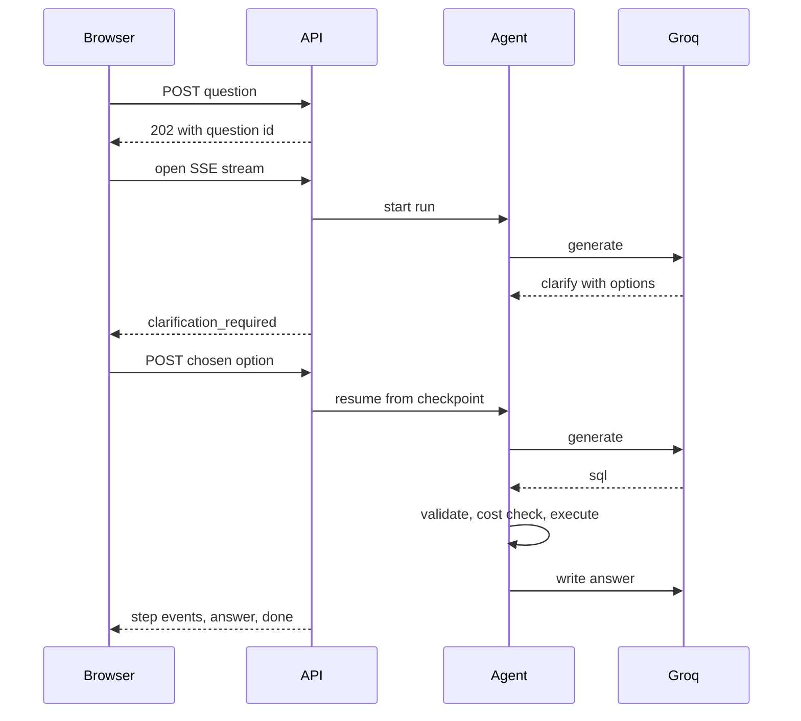
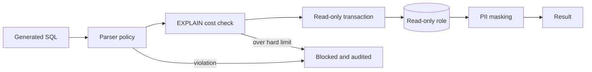
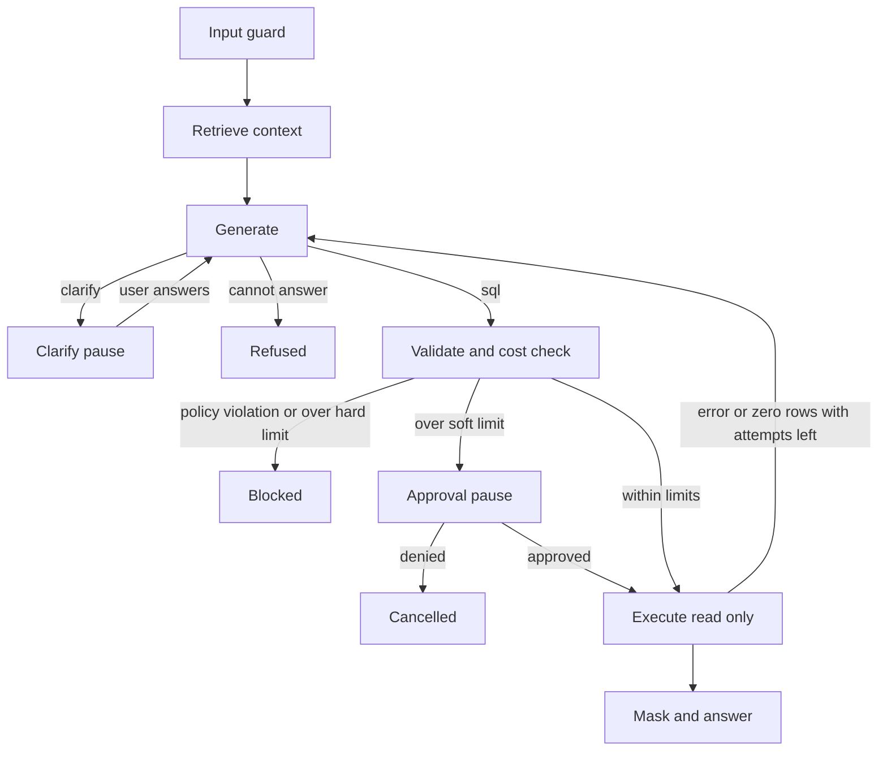
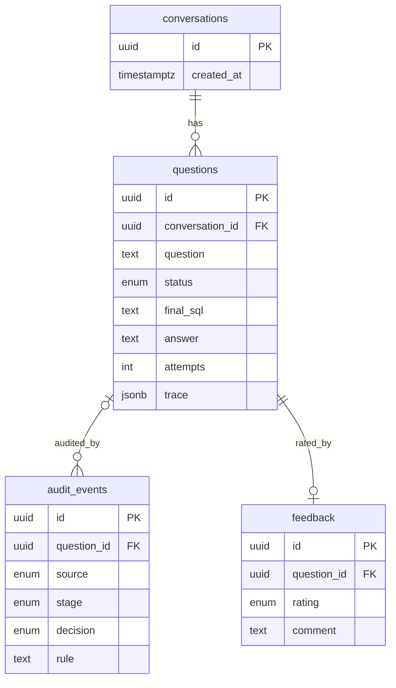

# QueryCraft

> Ask a PostgreSQL database questions in plain English. Every generated query is checked, read-only and audited.

**Demo video: (link coming soon)**

## What it does

QueryCraft is a text-to-SQL agent for teams that want answers from their database without writing SQL. You type a question; it writes a read-only query, runs it and replies with a short answer, the SQL, the tables used, its assumptions and the result table. The model is one replaceable part. Retrieval, a five-layer safety pipeline, human-in-the-loop steps and a measured evaluation make the answers safe to run and their accuracy known. The demo runs on AdventureWorks (67 queryable tables in five schemas) and uses only free-tier LLM and embedding APIs.

## How it works

- **Retrieve:** pgvector finds the relevant tables, admin-verified question→SQL examples and glossary terms; `pg_trgm` maps misspelled values (such as "Nortwest") to stored ones.
- **Generate:** Groq `gpt-oss-120b` at temperature 0 returns structured output (`sql`, `clarify` or `cannot_answer`), validated with Zod.
- **Clarify:** an ambiguous question pauses the run and asks the user to pick an option (at most 2 per question). The pause is checkpointed in Postgres, so it survives a restart.
- **Validate:** the real Postgres parser checks the SQL against allowlists. A violation ends the run as `blocked`; the model never gets a second try at a policy rule.
- **Cost check:** `EXPLAIN` estimates the cost. Above the soft limit the user must approve; above the hard limit the query is blocked.
- **Execute:** the query runs in a read-only transaction as a read-only database role, with a timeout and a row limit.
- **Self-correct:** an SQL error or an unexpected empty result sends the query back for a new attempt (at most 3 attempts).
- **Answer:** PII is masked, the answer model writes a short reply, and each step streams to the browser over Server-Sent Events. Every decision is written to an audit log.

## Key results

Measured on 2026-11-14 and 2026-11-16 (`server/evals/REPORT.md`), with test counts from 2026-11-17:

| Metric | Result |
|---|---|
| Execution accuracy on the 30-question benchmark (24 answerable) | **21/24 (88%)** |
| Overall benchmark | 26/30, including clarifying ambiguous questions and refusing unanswerable ones |
| Ablation: schema only vs + examples, glossary and value lookup | 13/24 (54%) → 21/24 (88%) |
| Unsafe executions on the 20-item attack set | **0 of 20** |
| Attacks stopped | 19 of 20 (4 blocked by the safety pipeline, 15 refused by the model; the remaining one ran a harmless, cheap query) |
| Safe questions wrongly blocked | 0/24 |
| SQL safety test cases | 213 malicious, 71 safe |
| Prompt tokens per question, with retrieval | 2,274 on average (all LLM calls of a question) |
| Full-schema SQL prompt, for comparison | about 7,263 tokens (character-count estimate; not run) |
| Automated tests | 1,064 (893 server, 171 client) |

Everything runs on free tiers: Groq for chat, Google Gemini for embeddings.

## Architecture



The server is layered Route → Middleware → Controller → Service → (Agent | Retrieval | Safety | Database). The HTTP API and the MCP server call the same services. Only the safety pipeline can reach the data database, and an architecture test enforces it. The app database holds history, audit events, embeddings and agent checkpoints. A per-IP rate limit and a daily token budget protect the public demo.

## Request flow

A question that needs a clarification, then streams its answer:



## Safety: defense in depth



- **Parser policy:** `pgsql-parser` (the real Postgres parser) allows only a single plain `SELECT`. Node types, functions, casts and schemas come from allowlists, and denied tables and columns are blocked.
- **Cost and execution:** `EXPLAIN` runs, never `EXPLAIN ANALYZE`. The query runs in a `READ ONLY` transaction with a 5-second timeout and a row limit added to the SQL text.
- **Database role:** `qc_reader` can only `SELECT` from granted base tables and columns. Even if every code layer were bypassed, it could not change data or read passwords and other denied columns; tests against the real database prove it.
- **Not prompt-dependent:** safety never relies on the prompt or the model. In a browser test, a user pushed the model until it wrote `DELETE FROM production.transactionhistoryarchive;`. The parser blocked it with `NOT_SELECT` and wrote a `blocked` audit row; nothing ran.
- **Every layer is tested on its own:** 213 malicious and 71 safe SQL cases, role tests and a test that keeps the policy in step with the database grants.

## Evaluation

- **Execution accuracy:** the gold SQL and the generated SQL both run through the safety pipeline. Their rows are compared as multisets (numbers rounded to 2 decimals, column names ignored).
- **Benchmark:** 30 questions (8 easy, 10 medium, 6 hard, 4 ambiguous, 2 unanswerable). A leakage guard keeps benchmark questions out of the prompt examples.
- **Attack set:** 20 items (writes, forbidden data, prompt injection, resource exhaustion, policy evasion). An execution counts as unsafe if its SQL fails re-validation or its result contains a forbidden column.
- **Ablation:** each config adds one part. `+schema` adds retrieved tables, `+context` adds examples, glossary and stored values, and `full` adds self-correction. One run per config.

| Metric | +schema | +context | full |
|---|---|---|---|
| Execution accuracy, answerable | 13/24 (54%) | 21/24 (88%) | 21/24 (88%) |
| Easy / medium / hard | 7/8 · 5/10 · 1/6 | 8/8 · 8/10 · 5/6 | 8/8 · 8/10 · 5/6 |
| Clarification on ambiguous | 1/4 | 2/4 | 3/4 |
| Correct refusal on unanswerable | 2/2 | 2/2 | 2/2 |
| False blocks | 0/24 | 0/24 | 0/24 |
| Average LLM tokens per question | 2,063 | 2,744 | 2,734 |
| Latency p50 (includes free-tier rate-limit waits) | 10.9 s | 13.0 s | 16.1 s |
| Unsafe executions | 0 | 0 | 0 |

`baseline` (the whole schema in the prompt) was not run: it would have used about 240k tokens of free-tier quota (Groq allows 200k tokens per model per day). Self-correction did not change accuracy in these runs, because every run averaged 1.00 SQL attempts.

## Engineering highlights

- **A deparser that changed query meaning:** `pgsql-deparser` turned `FETCH FIRST n ROWS WITH TIES` into `LIMIT n` and rewrote window frames. The row limit is now inserted into the original SQL text at parser token positions, and a re-parse proves the query is unchanged.
- **A library that dropped two output types:** `@langchain/groq` strict mode silently replaced the root union with its first variant, so the model could never return `clarify` or `cannot_answer`. Wrapping the union in a root object fixed it.
- **A time-zone date shift:** node-postgres read `date` and `timestamp` in the server's local zone (UTC+05:30), so `2024-01-01` arrived as `2023-12-31T18:30Z`. The executor now returns those types exactly as Postgres sends them.
- **PII in unexpected columns:** a review email column and two XML columns (contact details, job-candidate résumés) held emails and phone numbers. They are now masked or denied in both the policy and the grants, and a test checks that the two agree.
- **An allowlist gap:** a CTE `SEARCH` clause passed validation because unwrapped struct fields skipped the node-type check. Struct fields are now allowed only from an explicit list.
- **A flaky test under parallel load:** a dataset-wide dry run took 3.4 s alone but went past Vitest's 5 s default when 47 files ran in parallel. Only the timeout was raised; the assertions are unchanged.

## Tech stack

| Area | Technology |
|---|---|
| Client | React 19, Vite 8, Tailwind CSS 4, Zustand, axios, native `EventSource`, hand-built SVG charts |
| Server | Node.js 24, Express 5, TypeScript (strict, ESM), Zod 4, pino |
| Agent | LangGraph.js with the Postgres checkpointer |
| LLM | Groq free tier: `openai/gpt-oss-120b` (SQL), `openai/gpt-oss-20b` (answers) |
| Embeddings | Gemini free tier: `gemini-embedding-001`, 768 dimensions |
| Database | PostgreSQL 17, pgvector, `pg_trgm`, Drizzle ORM |
| SQL parser | `pgsql-parser` |
| MCP | Official MCP TypeScript SDK (stdio) |
| Tests | Vitest, Supertest |
| Tooling | pnpm, Docker Compose, Dockerfiles for server and client |

## Quick start

Prerequisites: Node.js 24, pnpm 12, Docker with Compose, and free Groq and Gemini API keys.

```sh
# 1. Env files: copy each example and fill in real values (see Setup details)
cp .env.example .env
cp server/.env.example server/.env
cp client/.env.example client/.env

# 2. Database (first build downloads AdventureWorks; wait for "healthy")
docker compose up -d --build

# 3. Server: dependencies, migrations, knowledge base
cd server
pnpm install
pnpm db:migrate
pnpm kb:introspect
pnpm kb:index
pnpm dev

# 4. Client (second terminal)
cd client
pnpm install
pnpm dev
```

Open <http://localhost:5173>. `GET http://localhost:4000/api/health` reports both databases. More detail is in [Setup details](#setup-details).

## MCP

The MCP server exposes the same safe pipeline to AI clients over stdio, with four tools: `list_tables`, `describe_table`, `run_safe_query` and `ask_question`. It reads `server/.env` itself and needs the database running and `pnpm build` in `server/`. It was checked with the MCP SDK's stdio client: `DELETE FROM sales.customer` was blocked with `NOT_SELECT`.

```sh
# Claude Code (stdio is the default; --scope user makes it available in every project)
claude mcp add querycraft -- <path-to-node> <path-to-repo>/server/dist/mcp/server.js
```

Claude Desktop (Settings → Developer → Edit Config, then restart the app fully):

```json
{
  "mcpServers": {
    "querycraft": {
      "command": "C:\\path\\to\\node.exe",
      "args": ["C:\\path\\to\\QueryCraft\\server\\dist\\mcp\\server.js"]
    }
  }
}
```

## Limitations and next steps

- **Bridge tables:** similarity-only retrieval misses tables that join two retrieved ones (such as `sales.customer` between stores and orders). Two benchmark misses come from this. Next step: foreign-key expansion of the retrieved tables.
- **Partial years:** orders run from 2022-05-30 to 2025-06-29, so "the latest year" covers half a year and period comparisons can mislead.
- **Single instance:** the rate limiter and the SSE event bus live in memory.
- **MCP:** stdio only. It cannot resume a clarification or approve an expensive query; such a query is refused with its cost estimate.
- **Small benchmark:** 30 questions, one run per config, so the accuracy numbers have wide error bars. Temperature 0 does not guarantee identical replies.
- **PII:** PII cannot be filtered, grouped or aggregated, so those questions go unanswered.

## Internals

### Agent graph



Both pauses are LangGraph interrupts saved by the Postgres checkpointer, so a paused run survives a server restart. A parse error also returns to `Generate` while attempts remain.

### App data model



The retrieval tables (`schema_tables`, `examples` and `glossary_terms` with 768-dimension HNSW vector indexes, and `column_values` with a trigram index) and `daily_usage` have no foreign keys. Result rows are never stored; a History re-run executes the SQL again through the safety pipeline.

## Setup details

**Env files** (never committed; `.env` files are also excluded from the Docker images):

- `.env`: database passwords for Docker Compose.
- `server/.env`: the database URLs (same passwords), `GROQ_API_KEY`, `GEMINI_API_KEY` and `ADMIN_TOKEN` (at least 32 characters, for example `node -e "console.log(require('crypto').randomBytes(32).toString('hex'))"`).
- `client/.env`: `VITE_API_BASE_URL=http://localhost:4000`.

**pnpm:** the server pins pnpm 12.18.0; any pnpm 12 downloads and uses that version automatically.

**Database:** the first `docker compose up` loads AdventureWorks and applies the read-only grants. The init scripts run only on an empty data volume (`docker compose down -v` deletes all data). `pnpm db:migrate` migrates both `querycraft_app` and `querycraft_test`.

**Knowledge base:** `kb:introspect` writes the granted tables to `seed/schema.json` and makes no provider calls. `kb:index` loads stored values and embeds tables, examples and glossary terms with Gemini, re-embedding only changed items. On the free tier the first run (115 items) can hit the per-minute limit; run it again after a minute to finish. Table descriptions are committed in `seed/table-descriptions.json`.

**Admin:** the Admin view is at `#/admin`. It asks for `ADMIN_TOKEN`, which is kept in memory only. Only the admin can verify the pending examples created by a thumbs-up.

**Production images** (deploy-ready, not deployed):

```sh
docker build -t querycraft-server server
docker build -t querycraft-client --build-arg VITE_API_BASE_URL=http://localhost:4000 client
docker run --env-file server/.env -e NODE_ENV=production --network container:querycraft-postgres querycraft-server
docker run -p 8080:80 querycraft-client
```

`--network container:querycraft-postgres` lets the `localhost` database URLs work unchanged. A real deployment would use its own network and publish port 4000. `CLIENT_ORIGIN` must match the client origin. Migrations and `kb:*` scripts run from a development checkout.

### Scripts

| Command | Where | Does |
|---|---|---|
| `pnpm dev` · `pnpm build` · `pnpm start` | server, client (`start`: server) | Dev server (4000 / 5173), compile, run the build |
| `pnpm typecheck` · `pnpm lint` · `pnpm test` | server, client | Checks; server tests use `querycraft_test` with mock LLM and embeddings |
| `pnpm db:generate` · `pnpm db:migrate` | server | Generate / apply Drizzle migrations |
| `pnpm kb:introspect` | server | Granted schema into `seed/schema.json` (free) |
| `pnpm kb:describe` | server | Draft missing table descriptions (Groq quota) |
| `pnpm kb:index` | server | Load values; embed changed items (Gemini quota) |
| `pnpm kb:top-tables` | server | Top retrieved tables for sample questions (Gemini quota) |
| `pnpm eval:run --config <name> [--dry-run] [--max-items N] [--resume <runId>]` | server | Evaluation; configs `baseline`, `+schema`, `+context`, `full`, `attacks`; real runs write `evals/REPORT.md` |
| `docker compose up -d --build` · `docker compose down` | repo root | Start / stop PostgreSQL |

### Project structure

| Path | Contents |
|---|---|
| `docker-compose.yml` · `infra/postgres/` | PostgreSQL 17 + pgvector with AdventureWorks; roles, data load and read-only grants |
| `client/src/features/` | `ask` (chat thread and composer), `sidebar` (conversations, theme) and `admin` views |
| `client/src/components/` · `lib/` · `stores/` | Shared UI, HTTP and SSE clients, Zustand stores |
| `server/src/http/` | Routes, controllers, middleware |
| `server/src/services/` | Business logic shared by the HTTP API and MCP |
| `server/src/agent/` | LangGraph graph, nodes, prompts, LLM client |
| `server/src/safety/` | Policy, validator, row limit, cost check, executor, masking |
| `server/src/retrieval/` | Embeddings, indexer, search, value lookup |
| `server/src/mcp/` | MCP stdio server and tools |
| `server/src/kb/` · `server/seed/` | Knowledge-base scripts and seed data |
| `server/evals/` | Datasets, runner, comparator, `REPORT.md` |
| `server/test/` | Unit, database, HTTP, MCP and architecture tests; SQL safety corpora |
